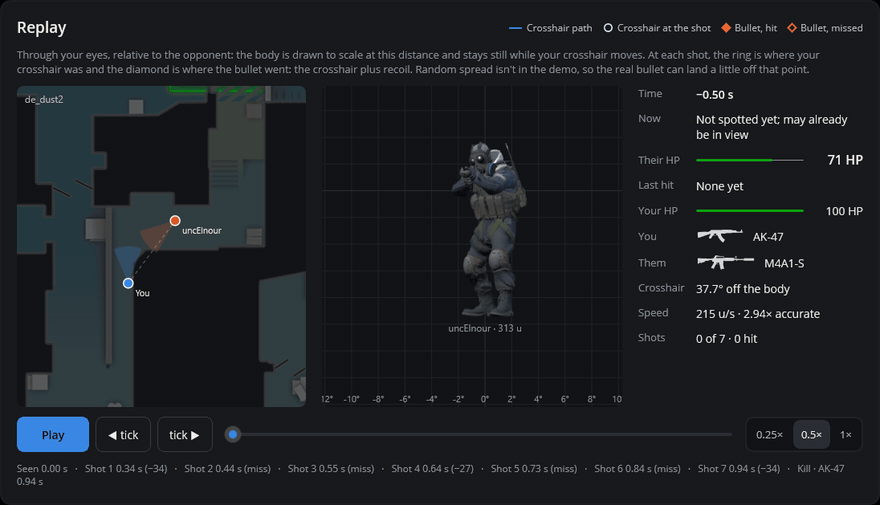
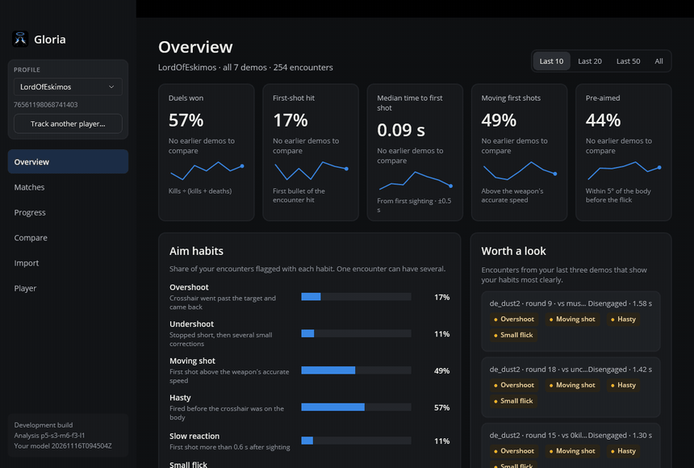
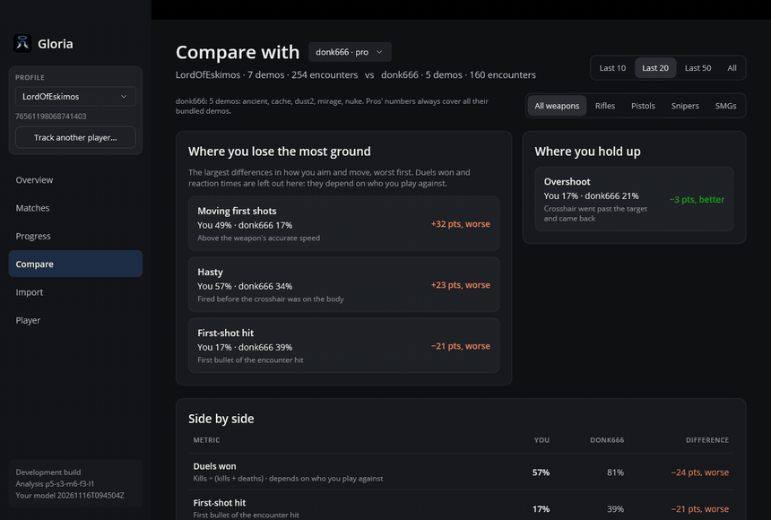

# Gloria

<p align="center"></p>
<p align="center">
  <a href="docs/media/overview.gif"></a>
  <a href="docs/media/compare.gif"></a>
</p>

Gloria is an aim coach for Counter-Strike 2. Load your demos, pick yourself by SteamID, and Gloria breaks every match into rounds and duels. For each duel it shows whether you overshot or undershot the target, whether you had stopped moving when you fired, and whether you shot too early or reacted too late. Across many demos it shows whether you are getting better.

## Install

You need Windows 10 (version 1809 or newer) or Windows 11, 64-bit.

1. Download **[Gloria-win-Setup.exe](https://github.com/xonium/Gloria/releases/latest/download/Gloria-win-Setup.exe)** from the [latest release](https://github.com/xonium/Gloria/releases/latest).
2. Run it. Gloria installs for your Windows user only, so no administrator rights are needed, and it starts when the install finishes. A Start menu shortcut is added.
3. Windows SmartScreen may warn about an unrecognized app the first time, because Gloria isn't code-signed yet. Click **More info**, then **Run anyway**. This happens only once, when you run Setup; updates don't trigger it.

Gloria is installed to `%LocalAppData%\Gloria`.

**No installer?** Download `Gloria-win-Portable.zip` from the same release, unzip it anywhere and run `Gloria.exe`.

## Updates

Gloria checks for a new version every time it starts. When there is one, it downloads it in the background, and the sidebar shows **Restart** when it's ready. Click it to apply the update. There is nothing to download or reinstall by hand.

## Your data

Your imported matches, profiles, corrections and personal aim model are kept in `%LocalAppData%\Gloria.Data`. That folder is separate from the app, so it survives updates and uninstalling. Delete it yourself if you want a clean start. Gloria doesn't need the `.dem` files after it has imported them.

## Uninstall

Open **Settings → Apps → Installed apps**, find **Gloria** and choose **Uninstall**.

## Building from source

You need the .NET 10 SDK and the MAUI Windows workload (`dotnet workload install maui-windows`).

```powershell
dotnet build Gloria.slnx
dotnet test -- --filter-not-trait "Category=Demo"
./build/pack.ps1 -Version 0.1.0   # builds Setup.exe into releases/
```

## Publishing a release

Push a version tag. The [Release workflow](.github/workflows/release.yml) tests, builds and packs the app, then publishes it to [GitHub Releases](https://github.com/xonium/Gloria/releases), where installed copies pick it up.

```powershell
git tag v0.2.0
git push origin v0.2.0
```

Each version must be higher than the last. A tag with a suffix, such as `v0.3.0-beta.1`, is published as a pre-release, and installed copies don't update to it.
